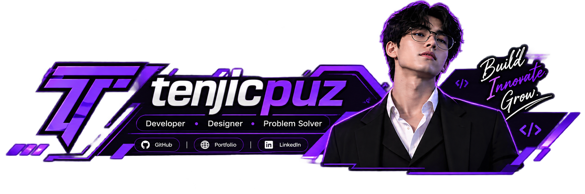
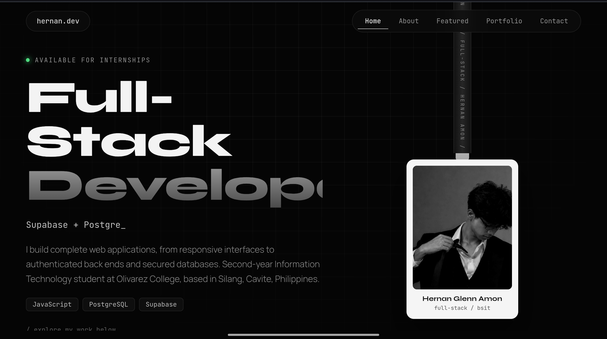

# Portfolio



**BSIT Student · Independent Creator · Aspiring Developer**

------------------------------------------------------------------------

## About

Welcome to my personal portfolio repository. I'm Hernan Glenn Belarmino
Amon, a second-year Bachelor of Science in Information Technology
student at Olivarez College, based in Silang, Cavite, Philippines.

I build independent projects to strengthen my programming skills,
explore web technologies, and turn ideas into practical digital tools.

## Preview



## Highlights

-   Responsive portfolio layout for desktop and mobile
-   Draggable hanging ID card, scroll progress bar and reveal animations
    (all switched off for visitors who prefer reduced motion)
-   Projects loaded from my public GitHub repositories, with search and
    language filters
-   Live GitHub profile statistics and recent activity
-   Certificate gallery connected to Supabase, with a preview you can
    step through
-   Profile picture and contact links managed from a private dashboard
-   Print-friendly layout for saving the portfolio as a PDF

## Tech Stack

  Technology                        Purpose
  --------------------------------- -------------------------------------------
  HTML5                             Page structure
  CSS3                              Styling, layout, and responsive design
  JavaScript                        Interactive features and dynamic content
  GitHub API                        Public repository and profile information
  Supabase                          Certificate gallery and contact-link data
  GitHub Pages / Cloudflare Pages   Website hosting and deployment (custom domain)

## Repository Structure

``` text
.
├── index.html           public site (markup and styles)
├── site.js              public site behaviour
├── admin.html           private owner dashboard
├── admin.js
├── config.js            public Supabase URL and anon key
├── supabase_setup.sql   the one database setup file (safe to re-run)
├── 404.html
├── sitemap.xml
├── robots.txt
├── CNAME                custom domain
├── favicon.ico / favicon.png / og-image.png
├── banner.png / preview.png
├── google255eb07db4aa57cb.html   Search Console verification (keep it)
└── .nojekyll
```

## Run Locally

1.  Clone the repository:

    ``` bash
    git clone https://github.com/tenjicpuz/Portfolio-SRC.git
    ```

2.  Open the project folder:

    ``` bash
    cd Portfolio-SRC
    ```

3.  Open `index.html` in your browser.

Some features, including the certificate gallery and contact management,
require the appropriate Supabase configuration. For the best result,
serve the folder with any static server (for example
`python3 -m http.server`) instead of opening the file directly.

## Configuration

The website uses `config.js` for its public client-side configuration.
Add the required Supabase project URL and anon key there if you want to
enable the connected features.

Run `supabase_setup.sql` once in the Supabase SQL Editor, then turn off
"Allow new users to sign up" under Authentication. Every write is
restricted to the owner account by database policies.

**Security note:** Never place a Supabase service-role key, private API
key, or account password in a public repository. Use only the public
anon key with properly configured Row Level Security policies.

## Deployment

The site can be hosted using a static hosting provider such as GitHub
Pages or Cloudflare Pages.

For the live version, visit
**[tenjicpuz.is-a.dev](https://tenjicpuz.is-a.dev/)**.

## Connect

-   **Portfolio:** https://tenjicpuz.is-a.dev/
-   **GitHub:** https://github.com/tenjicpuz
-   **Social profile:** https://guns.lol/kensojukisaki

------------------------------------------------------------------------

*Built and maintained by Hernan Glenn Belarmino Amon.*
